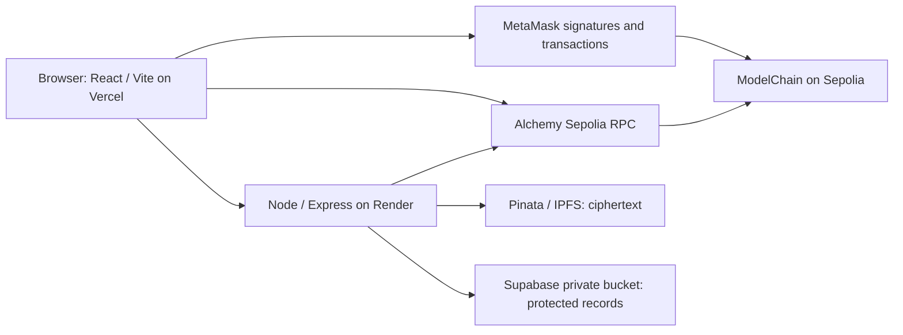

# Technical architecture

[Documentation home](../README.md) · [Security boundaries](SECURITY_NOTES.md)

## Components and data placement

| Component | Responsibility |
| --- | --- |
| `frontend/src/` | Catalogue and wallet UI, chain reads, SHA-256 file checks, API sessions, purchases and provenance |
| `backend/src/app.js` | HTTP API, challenge signatures, sessions, input limits and independent authorization |
| `backend/src/storage.js` | AES-256-GCM encryption, random per-file keys, key wrapping, SHA-256 and Pinata V3 uploads |
| `backend/src/record-store.js` | Private persistent records scoped by chain and contract |
| `contracts/ModelChain.sol` | Registry, licenses, pricing, creator share, activation and pull payments |
| `scripts/deploy.ts` | Guarded localhost/Sepolia deployment and no-transaction preflight |
| Supabase profiles | Optional app profile identity; separate from protected storage and licensing |

The contract stores ID, owner, name, CID, original SHA-256 string, price, creator share and active flag. Description, category, sanitized filename, ciphertext hash and wrapped file key live in a protected record. In production its object path is `11155111/<lowercase-contract-address>/<cid>.json` in `montai-private-records`. The backend exposes selected descriptive metadata publicly, never the wrapped key. Local development may use encrypted filesystem storage; production requires Pinata and persistent private records and does not fall back to local key records.

## Creator sequence

1. Browser computes SHA-256 of selected bytes and connects MetaMask.
2. Backend issues a random five-minute challenge bound to origin/chain/contract/address; MetaMask signs it. Backend recovers the signer, consumes the nonce and creates a one-hour in-memory bearer session.
3. Authenticated multipart upload reaches the backend (25 MB limit). Backend generates a random 32-byte file key and AES-GCM encrypts the bytes with a fresh IV.
4. Pinata V3 public IPFS upload receives ciphertext only. Backend wraps the file key with the stable master key and saves a protected record durably before returning CID and plaintext hash.
5. Browser verifies returned hash against the selected file, rechecks the wallet, submits `registerModel`, and waits for a successful receipt and `ModelRegistered` event.

Encrypted upload and registration are separate operations; they are not an atomic cross-service transaction. A rejected registration can leave stored ciphertext/record without a chain listing.

## Buyer and delivery sequence

1. Browser reads current price/status and `hasLicense`; MetaMask submits `purchaseLicense(id)` with exactly the price.
2. Contract rejects invalid IDs, inactive listings, owner purchases, duplicate licenses and incorrect payment; records the buyer license and credits recipient balances. Browser waits for mining and rechecks wallet/license.
3. For download, backend authenticates the signature session and independently reads `getModel` and `hasLicense`. Only the owner or licensed address passes. A UI badge or profile login cannot authorize delivery.
4. Backend validates record CID/hash/owner against chain state, retrieves cached or gateway ciphertext, checks ciphertext SHA-256, unwraps the key, decrypts with GCM authentication and checks plaintext SHA-256.
5. Backend returns plaintext over HTTPS with `Cache-Control: no-store`; browser checks SHA-256 against the chain record before download. A changed wallet interrupts stale access in the UI.

## Contract API and revenue

| Function | Behavior |
| --- | --- |
| `registerModel(name,cid,modelHash,price,royalty)` | Registers caller as owner; positive price; share 0–100 |
| `getModel(id)`, `getModelCount()` | Registry reads |
| `purchaseLicense(id)` | Exact payment; records non-owner buyer license |
| `hasLicense(id,address)` | License lookup; owner access is checked separately |
| `setModelActive(id,bool)` | Creator-only new-sale availability |
| `pendingWithdrawals(address)` | Accrued recipient balance |
| `withdrawRevenue()` | Caller withdraws own credit; balance zeroed before external call |
| `verifyModel(id,submittedHash)` | Compares supplied hash string to stored hash string |

`royalty` means creator share of each purchase, in whole percent, not a secondary-sale mechanism. Integer division rounds creator credit down; platform gets the remainder, preserving the entire payment. The immutable platform address is the deploying wallet. `RoyaltyPaid` denotes accrual; actual transfer occurs on withdrawal and emits `RevenueWithdrawn`. Registration, purchase and status events support Activity/provenance. Current contract is non-upgradeable; no token/NFT transfer or license migration function is implemented.

## HTTP API

| Method / route | Requirement and result |
| --- | --- |
| `GET /health` | Public contract read; status, chain ID and address |
| `POST /api/auth/challenge` | JSON public address; returns nonce and message |
| `POST /api/auth/session` | JSON nonce/signature (optional address); returns bearer token |
| `GET /api/auth/session` | Bearer session; returns authenticated address |
| `DELETE /api/auth/session` | Bearer session; revokes it |
| `POST /api/uploads` | Bearer session; multipart `model`, name, description, category |
| `GET /api/models/:id/metadata` | Public descriptive metadata checked against chain |
| `GET /api/models/:id/download` | Bearer session plus owner/license; returns bytes or 403 |

API rate limit is 60 requests/minute under `/api`; JSON limit is 16 KB. In-memory sessions/challenges disappear on restart. Use a single replica until a shared session store exists. Health is not a complete Pinata/Supabase end-to-end acceptance test.

## Meaning and limits of verification

Authentication answers “does this caller control this address?” Authorization answers “does this address own or license this model?” Blockchain addresses are pseudonymous, not verified real-world identities. SHA-256 matches demonstrate byte integrity relative to a registered reference. Contract `verifyModel` compares hash strings; it does not run SHA-256 over model bytes or evaluate models.

The backend handles plaintext and keys and is a trusted delivery component. A compromised backend or master key breaks confidentiality. Authorized buyers can copy plaintext; there is no perfect DRM, runtime use metering or automatic enforcement of legal terms. No model execution, malware scanning, quality scoring or safety certification is implemented. Catalogue enumeration is suitable for a small project; Activity queries use 10-block ranges and a deployment floor rather than a full-history indexer.
